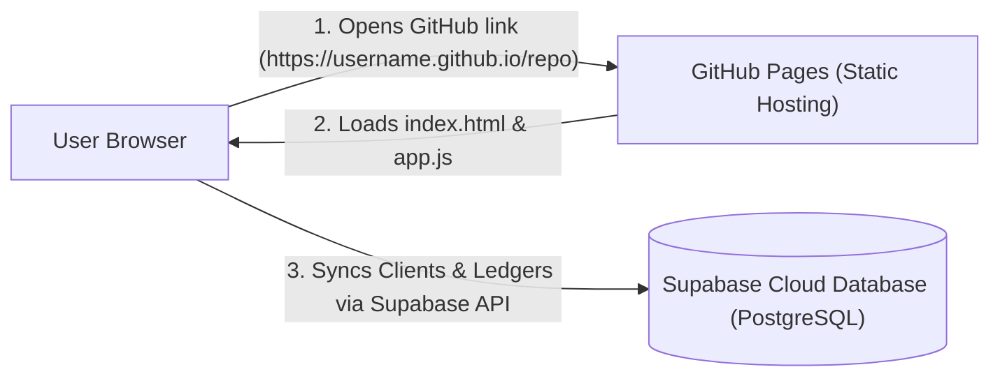

# ⚡ Complete Guide: Connect GitHub Pages with Supabase Database

This guide explains how to host your application on **GitHub Pages** and connect it to a free **Supabase Cloud Database** (PostgreSQL).

---

## 🏗️ How the Architecture Works



* **Frontend Hosting (GitHub Pages)**: Runs your HTML, JavaScript, and CSS. Provides your live public web link.
* **Backend Database (Supabase)**: Stores all your clients, payments, monthly ledger overrides, and business profile safely in the cloud with automatic SSL and zero maintenance.

---

## 📁 1. Which Files to Upload to GitHub?

Upload only the files needed for your application to run in the browser:

### ✅ Files to Upload to GitHub:
| File Name | Purpose |
| :--- | :--- |
| **`index.html`** | Main application webpage & UI layout |
| **`app.js`** | Core ledger calculations, login logic & Supabase sync engine |
| **`styles.css`** | Custom design, badges, animations & print layout |
| **`supabase_schema.sql`** | Database schema script (safe to keep in repository for backup) |
| **`README.md`** | Project documentation |

### ❌ Files NOT Needed on GitHub:
* `server.js` & `start.bat` *(Only used for running locally on your computer with Node.js)*
* `api.php` & `database.sql` *(Only used if you were using BigRock MySQL hosting)*

---

## 🟢 2. How to Create the Supabase Database (Step-by-Step)

### Step 1: Create a Free Account
1. Go to [supabase.com](https://supabase.com).
2. Click **Start your project** and sign in with your GitHub account (1 click).

### Step 2: Create a New Project
1. In the Supabase dashboard, click **+ New project**.
2. Fill in the details:
   * **Name**: `clientledger` (or any name you prefer)
   * **Database Password**: Set a strong password (keep this saved for your records)
   * **Region**: Choose the closest region (e.g. `South Asia (Mumbai)` or `Southeast Asia (Singapore)`)
   * **Pricing Plan**: Free plan (defaults to 100% free)
3. Click **Create new project** and wait ~1 minute for Supabase to finish provisioning.

### Step 3: Run the Database Schema Script
1. In your Supabase project dashboard, click on **SQL Editor** in the left sidebar (icon with `>_`).
2. Click **+ New Query**.
3. Open [**`supabase_schema.sql`**](file:///d:/BRT%20Application/Rahul%202.0/supabase_schema.sql) from your project folder, copy all contents, and paste into the query editor:

```sql
-- 1. Create table
CREATE TABLE IF NOT EXISTS public.clientledger_data (
    id TEXT PRIMARY KEY,
    data JSONB NOT NULL,
    updated_at TIMESTAMP WITH TIME ZONE DEFAULT timezone('utc'::text, now()) NOT NULL
);

-- 2. Enable Row Level Security (RLS)
ALTER TABLE public.clientledger_data ENABLE ROW LEVEL SECURITY;

-- 3. Allow public access with anon key
DROP POLICY IF EXISTS "Allow anon all" ON public.clientledger_data;
CREATE POLICY "Allow anon all"
ON public.clientledger_data
FOR ALL
TO anon, authenticated
USING (true)
WITH CHECK (true);

-- 4. Enable Supabase Realtime broadcast for instant live sync across devices
DO $$
BEGIN
  IF EXISTS (SELECT 1 FROM pg_publication WHERE pubname = 'supabase_realtime') THEN
    ALTER PUBLICATION supabase_realtime ADD TABLE public.clientledger_data;
  END IF;
EXCEPTION
  WHEN duplicate_object THEN NULL;
END $$;

-- 5. Initial placeholder
INSERT INTO public.clientledger_data (id, data)
VALUES ('main_store', '{"clients":[],"settings":{"currency":"₹","businessName":"Business Services & Solutions"}}'::jsonb)
ON CONFLICT (id) DO NOTHING;

-- 6. Helper Views for Supabase Table Editor
CREATE OR REPLACE VIEW public.v_clients AS
SELECT 
    c->>'id' AS client_id,
    c->>'name' AS client_name,
    c->>'businessName' AS business_name,
    c->>'phone' AS phone,
    c->>'email' AS email,
    COALESCE((c->>'hasGst')::boolean, false) AS has_gst,
    c->>'gstNumber' AS gst_number,
    c->>'billingCycle' AS billing_cycle,
    COALESCE((c->>'fixedMonthlyAmount')::numeric, 0) AS fixed_monthly_fee,
    COALESCE((c->>'extraFee')::numeric, 0) AS extra_fee,
    c->>'startMonth' AS start_month,
    c->>'status' AS status,
    jsonb_array_length(COALESCE(c->'payments', '[]'::jsonb)) AS payments_count
FROM public.clientledger_data,
     jsonb_array_elements(COALESCE(data->'clients', '[]'::jsonb)) AS c
WHERE id = 'main_store';

CREATE OR REPLACE VIEW public.v_payments AS
SELECT 
    p->>'id' AS payment_id,
    c->>'name' AS client_name,
    COALESCE((p->>'amount')::numeric, 0) AS amount_paid,
    COALESCE((p->>'discount')::numeric, 0) AS settlement_discount,
    p->>'discountNote' AS discount_note,
    p->>'date' AS payment_date,
    p->>'method' AS payment_method,
    p->>'reference' AS reference,
    p->>'note' AS note
FROM public.clientledger_data,
     jsonb_array_elements(COALESCE(data->'clients', '[]'::jsonb)) AS c,
     jsonb_array_elements(COALESCE(c->'payments', '[]'::jsonb)) AS p
WHERE id = 'main_store';
```

4. Click the green **Run** button (or press `Ctrl + Enter`).
5. You will see: **`Success. No rows returned`**. Your database is now ready!

### Step 4: Copy Your API Keys
1. In the left sidebar of Supabase, click on **Project Settings** (gear icon ⚙️ at bottom left).
2. Click on **API** in the settings menu.
3. Copy two values:
   * **Project URL**: e.g., `https://abcdefghijklm.supabase.co`
   * **Project API keys → `anon` `public`**: e.g., `eyJhbGciOiJIUzI1NiIsInR5cCI6IkpXVCJ9...`

---

## 🟡 3. How the Connection is Done

There are **two ways** to connect your GitHub application to Supabase:

### Method A: Through the Web Application (No Code Editing Required)
1. Open your live GitHub Pages link: `https://your-username.github.io/clientledger/`.
2. Sign in with:
   * **Login ID**: `rahul`
   * **Password**: `1990`
3. Click the top-bar badge **Local Mode** (or click **Settings ⚙️ → Cloud Database Connection**).
4. In the modal:
   * Paste your **Supabase Project URL**.
   * Paste your **Supabase Anon API Key**.
5. Click **⚡ Test Connection**:
   * It will display: **`✅ Connected! Supabase PostgreSQL database is online and reachable.`**
6. Click **Save & Connect**.
7. The badge turns green: **`Supabase Cloud Synced 🟢`**. All your data is now synced to the cloud!

---

### Method B: Pre-configured in Code (Recommended for Multi-user Access)
If you want anyone opening the GitHub link to connect to your Supabase database automatically without typing keys into the popup:

1. Open [**`app.js`**](file:///d:/BRT%20Application/Rahul%202.0/app.js#L9-L13) on your computer.
2. Put your keys inside `SUPABASE_CONFIG`:
   ```javascript
   const SUPABASE_CONFIG = {
     url: 'https://abcdefghijklm.supabase.co',
     anonKey: 'eyJhbGciOiJIUzI1NiIsInR5cCI6IkpXVCJ9.ey...',
   };
   ```
3. Push the file to GitHub. Now, whenever you or anyone opens the website, it will immediately connect and sync to your Supabase database!

---

## 🟣 4. Push Files to GitHub & Turn on GitHub Pages

Open PowerShell in `D:\BRT Application\Rahul 2.0` and run:

```bash
# 1. Initialize git
git init

# 2. Add files
git add index.html app.js styles.css supabase_schema.sql README.md

# 3. Commit
git commit -m "Deploy ClientLedger Pro with Supabase database"

# 4. Set branch
git branch -M main

# 5. Link GitHub repository (replace with your real URL)
git remote add origin https://github.com/your-username/clientledger.git

# 6. Push
git push -u origin main
```

### Turn on GitHub Pages:
1. Go to your repository on [github.com](https://github.com).
2. Go to **Settings** → **Pages** (in left sidebar).
3. Under **Build and deployment** → **Branch**, select **`main`** and **`/ (root)`**, then click **Save**.
4. Within 1 minute, GitHub will show your link:
   **`https://your-username.github.io/clientledger/`**
